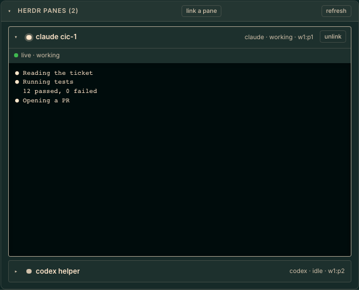

# hermes-kanban-herdr

A Hermes dashboard plugin that adds a **Herdr panes** section to the kanban task drawer: the
panes working on a task, one open at a time, with a live, read-only view of the open pane.



## What it does

- Lists the [Herdr](https://herdr.dev) panes linked to the task, with agent and status.
- Click a pane to open it (accordion: opening one closes the other). The terminal text streams
  live while it is open.
- **link a pane** attaches any existing pane to the task; **unlink** detaches it.
- Panes that have closed stay listed under the task as history.
- Read-only: the plugin never sends keys or input to a pane and never closes one.

## How panes get linked

1. **Tag** (automatic): the pane carries Herdr tokens `kanban_task=<task_id>` (and optionally
   `kanban_board=<board>`):

   ```
   herdr pane report-metadata <pane_id> --source kanban-link \
     --token kanban_task=<task_id> --token kanban_board=<board>
   ```

   Run it without `--ttl-ms` so the tag persists. The `herdr-dispatch` skill can do this when
   it opens a pane for a card.
2. **Manual**: use **link a pane** in the drawer. This sets the same tokens and also stores the
   link in `<HERMES_HOME>/plugin-data/kanban-herdr/links.json` (override with `KANBAN_HERDR_DATA`).

Tokens are a hint for display, not authorization.

## Install

```
git clone https://github.com/zachristmas/hermes-kanban-herdr ~/.hermes/plugins/kanban-herdr
```

Add `kanban-herdr` to `plugins.enabled` in the Hermes config, then **restart the dashboard**.
Unlike front-end-only plugins, this one has a backend (`plugin_api.py`), and Hermes mounts
plugin routes only when the dashboard starts; a rescan is not enough. Front-end changes after
that only need a hard refresh.

The dashboard host must be able to reach Herdr's socket (`HERDR_SOCKET_PATH`, default
`~/.config/herdr/herdr.sock`). If it can't, the section says so.

## Security notes

- Pane text can contain anything the terminal printed, including secrets. The stream is served
  only behind the dashboard's own login (same auth as the rest of the plugin API).
- Pane ids and task/board ids are validated; at most 4 concurrent streams; text is stripped of
  control characters and capped at 256 KB per snapshot.
- The view is a snapshot of the pane's recent screen text, refreshed on each Herdr update
  (coalesced), not a raw byte stream. Colours are not rendered.

## Platform

Developed and tested against Herdr 0.9.3 on macOS. It uses Herdr's unix socket, so Windows is
unverified.

## Testing

```
python3 -m unittest discover -s tests      # API tests against a fake Herdr socket (22)
```

Browser tests (Playwright, `data-testid` selectors) need a dashboard with the plugin enabled
and `HERDR_SOCKET_PATH` pointing at the fake server:

```
python3 tests/fake_herdr.py /tmp/khd-fake.sock &
HERDR_SOCKET_PATH=/tmp/khd-fake.sock hermes dashboard --port 9229 --no-open &
FAKE_HERDR_SOCK=/tmp/khd-fake.sock npm run e2e
```

Unix socket paths are length-limited on macOS; keep the fake socket path short.

## License

MIT
